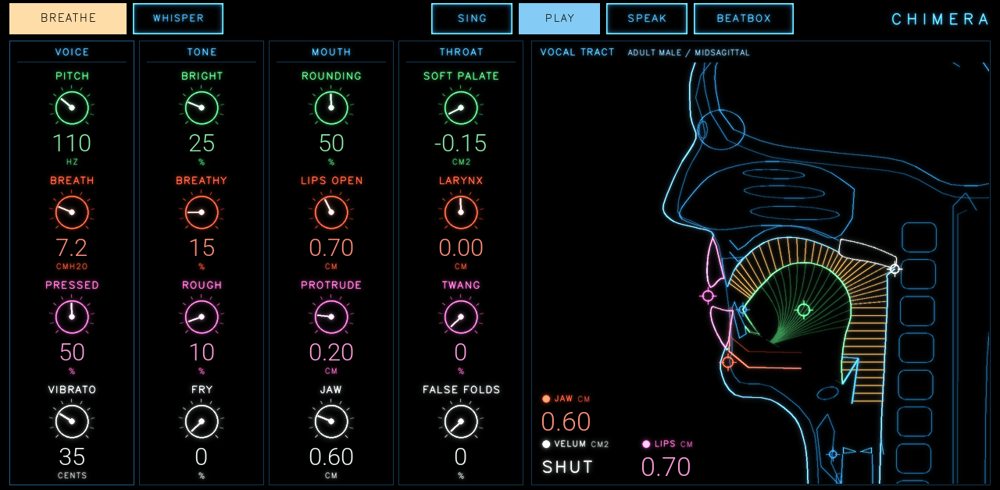
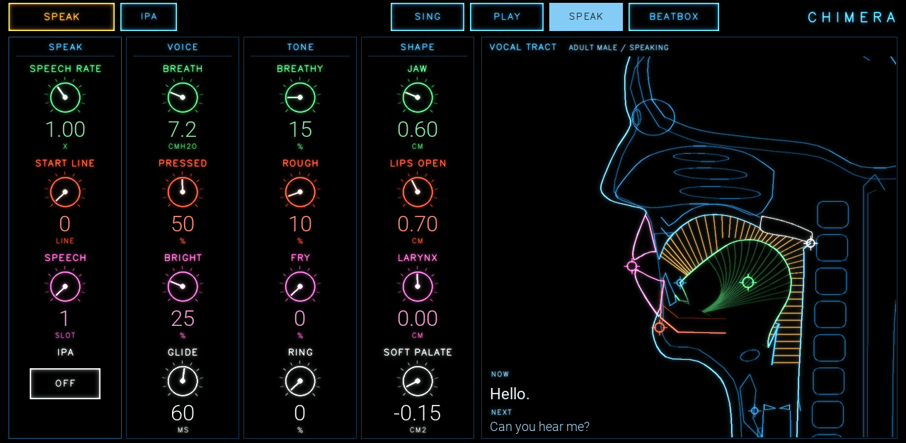
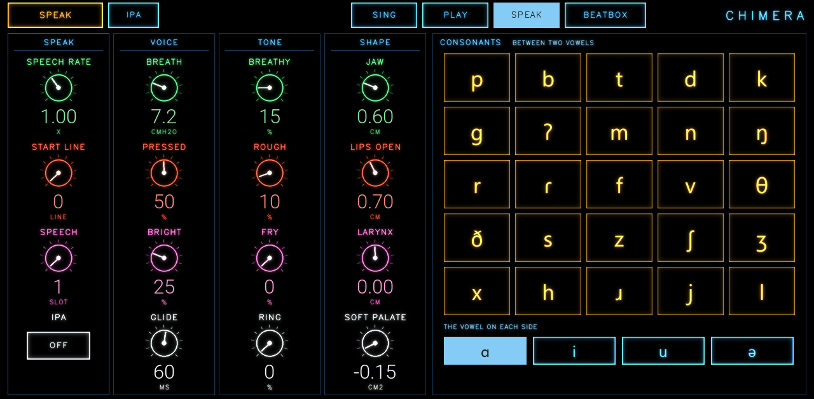
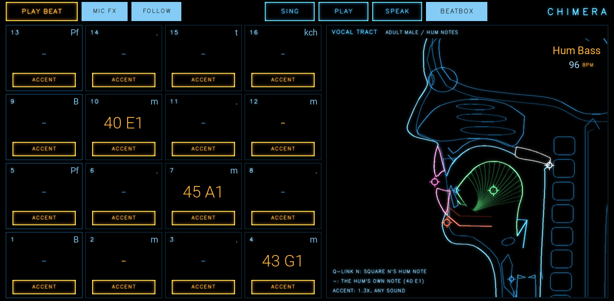
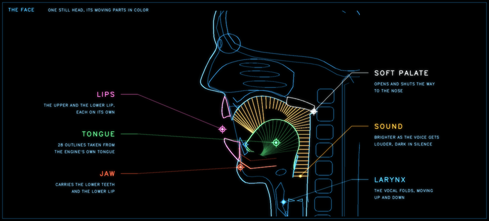
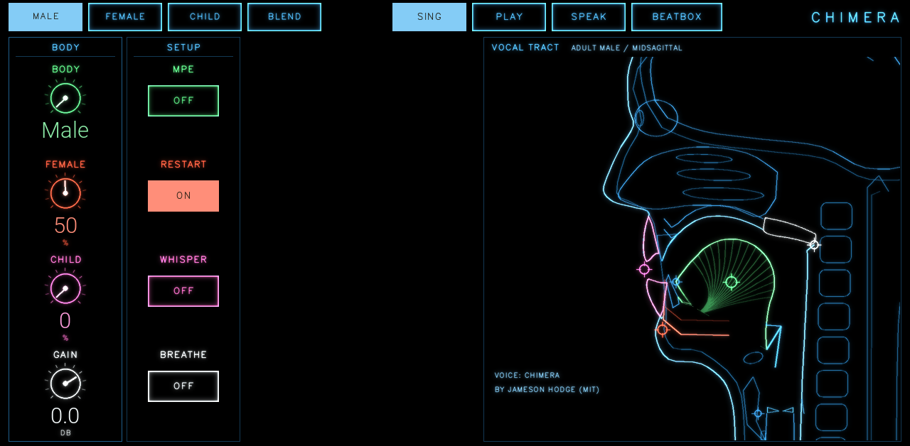

<p align="center">
  
</p>

<p align="center">
  
  
  
  
  
</p>

<p align="center">
  <b>CHIMERA's physical-model voice on Akai MPC standalone hardware.<br>
  It sings your lyrics, holds a vowel, speaks your lines and beatboxes, and none of it is a sample.</b><br>
  <sub>By anthonytheinventor · voice engine: CHIMERA by Jameson Hodge</sub>
</p>

<p align="center">
  <br>
  <sub>The SING page singing lyrics line 1, one note a syllable. The face's frames are the engine's own.</sub>
</p>

---

## The voice

[CHIMERA](https://github.com/jamesondh/chimera-vocal-synth) is a voice synthesizer by Jameson Hodge.
Every sound it makes comes from a simulated airway, not from samples. CHIMERA MPC runs CHIMERA's own
engine, with settings that let it fit a 32-bit MPC.

<table>
<tr>
<td width="50%" valign="top">

**What's simulated**

- the **lungs**, pushing air
- the **vocal folds**, opening and closing on it
- the **throat**
- the **mouth**: tongue, jaw and lips
- the **nose**, behind the soft palate

</td>
<td width="50%" valign="top">

**What you get on the MPC**

- four modes: **Sing**, **Play**, **Speak**, **Beatbox**
- four bodies: **Male**, **Female**, **Child**, **Blend**
- your own words, typed on the touch screen
- a 16-step beat played from the pads
- a head in profile that moves with the voice

</td>
</tr>
</table>

## Four modes

**Mode** picks how notes play. The mode chips in the top bar switch it from any page.

| Mode | A note... | Without a key |
|---|---|---|
| **Sing** (the default) | sings the next syllable of the lyrics | |
| **Play** | sings one held vowel at its pitch | **Breathe** holds the voice on; **Pitch** sets its pitch |
| **Speak** | says the next line of the chosen text | **Speak** says the next line; a consonant button says one consonant |
| **Beatbox** | hits a beatbox sound, or hums | **Play Beat** runs the 16-step beat; **Pad** hits one sound |

### Sing

Each note sings the next syllable of the lyrics, as CHIMERA's Sing mode does.

- **Lyrics** picks one of eight lines from `Content/lyrics.txt` in the plugin folder. Edit that file on
  the drive to sing your own words, or type them on the WORDS page.
- **Start Syl** sets where the lyrics start.
- On the SING page, in front of the face, **NOW** shows the syllable just sung and **NEXT** the one
  the next note sings. A vowel carried on to the next note (a `-` or `~` between spaces in the lyrics)
  reads as its syllable with a `~`.
- With **Restart** on, Sing and Speak start again from Start Syl and Start Line each time the MPC's
  transport starts.
- The first moment after loading, while the pronunciation dictionary loads, a note sings "ah".

### Play

<p align="center">
  
  &nbsp;
  
</p>

A note sings one held vowel at its pitch. Play legato: the last key held sets the pitch.

- The voice breathes while a key is down, or all the time with **Breathe** on. **Pitch** sets the pitch
  without a key.
- How hard you play a key sets the breath (as Sing's notes do): soft keys breathe gently, hard ones push
  harder and brighter.
- The mouth and throat controls shape the vowel. Each one moves its own part of the head on the screen.
- The vowel pad (**Front** and **Open**, on the VOWEL page) blends CHIMERA's calibrated vowels and moves
  those controls to match. Drag across the chart to set both.

### Speak

<p align="center">
  
  &nbsp;
  
</p>

Each note says the next line of the chosen text.

- **Speech** picks one of eight blocks of lines in `Content/speech.txt` (blocks are separated by a blank
  line). **Start Line** sets where it starts and **Speech Rate** how fast it talks.
- C3 speaks at the body's natural pitch. Other keys move the whole line up or down, up to two octaves.
- On the SPEAK page, under the chin, **NOW** shows the line just said and **NEXT** the line the next
  note says. A line longer than the screen's 31 characters ends in "…".
- With **IPA** on, the text is read as IPA.
- **Speak** says the next line without a key.
- On the SOUNDS page, **Consonant** says one consonant between two vowels, as CHIMERA's consonant chart
  does. Tap a button to say it; **Pad Vowel** picks the vowel around it.

### Beatbox

<p align="center">
  
  &nbsp;
  
</p>

A 16-step pattern of beatbox sounds, every one of them made by the mouth.

- **Beat** picks one of CHIMERA's seven patterns (it fills the steps, their hum notes and accents,
  Tempo and Swing) or keeps **Your Beat**. It's the first knob on KIT; on BEATBOX, tap the beat's name
  (in front of the face) and turn the data wheel, or double-tap it for the list.
- With **Follow Host** on (the default), Tempo is the MPC's tempo, so **Play Beat** runs at it, and
  while the MPC's sequence runs the beat plays along with it. With Follow Host off, **Play Beat** runs
  on the beat's own Tempo.
- The MPC's pads 1-16 each play the sound in the BEATBOX square with the same number, and the square
  lights up. The beat lights its squares as it plays them.
- The squares are laid out as the MPC's pads, 1-4 on the bottom row and 13-16 on top, and Q-Link n turns
  square n.
- **Pad 1 Note** (top right of BEATBOX, and a knob on KIT) is the note pad 1 sends; pads 2-16 follow a
  semitone apart. It starts at 36 (C1), the MPC's Chromatic C1 layout. **Classic** is the classic MPC
  layout (pad 1 sends 37, pad 2 36, pad 3 42, pad 4 82, and on).
- If the pads light the wrong squares, tap **LEARN ALL 16**, then hit pads 1 to 16 in turn: the square
  whose pad to hit next stays lit. Each pad's note is kept for its own square, so any layout works
  (chromatic, a key or scale, another bank), and Pad 1 Note then says **Custom**. A pad hit twice by
  mistake doesn't skip a square.
- For a chromatic layout, **LEARN PAD 1** is quicker: tap it, then pad 1. That note becomes Pad 1 Note
  (37 picks Classic), and pads 2-16 follow a semitone apart.
- **LAST NOTE** shows the note last played, so one tap on a pad shows the note it sends.
- Other keys below C3 hit drum sounds (General MIDI's drum map), and keys from C3 up hum two octaves
  lower; the pads' 16 notes play their squares first. **Pad** hits a sound without a key.
- **Mic FX** is CHIMERA's close-mic sound.

<p align="center">
  
</p>

On the NOTES page (press BEATBOX a third time), each square has a hum note and an accent. The squares
are laid out as on BEATBOX, and Q-Link n turns square n's **Note**.

- **Note** is the pitch the square hums at when its sound is `m`, named as the MPC names notes (60 is
  C3, 36 is C1), from 24 (C0) to 60 (C3). `-` hums at the hum's own note, 40 (E1). The note shows in
  amber on the squares that hum.
- **Accent** hits the square's sound 1.3 times as hard, as CHIMERA's `>` does. On a pad, it multiplies
  the pad's velocity.
- The beat and the pads both play the notes and accents. **Hum Bass** fills in its bass line (G1 on
  square 4, A1 on 7, E1 on 10); the other patterns put every note back to `-` and every accent off.
  Changing a square's sound keeps its note and accent.

| | | | | | | | | | | |
|---|---|---|---|---|---|---|---|---|---|---|
| **Sound** | Kick | Hat | Snare | Rim | Inward | Click | Pop | Open Hat | Crash | Hum |
| **Step** | `B` | `t` | `Pf` | `K` | `^K` | `!` | `P!` | `tss` | `kch` | `m` |

## Typing your own words

<p align="center">
  
</p>

On the WORDS page (function key 5), pick **Type Into** (Speak or Sing: what Speak says or what Sing
sings) and **Type Slot** (1 to 8), then type on the keyboard.

| Key | What it does |
|---|---|
| **Del** | Takes back the character before the cursor. |
| **Clear** | Empties the slot. |
| **Line** | For Speak, starts a new line: each note says the next line. |

- The slot starts with the line from the text file. What you type replaces it and is saved with the
  project. A slot holds up to 1024 characters.
- A moment after you stop typing, the next note says (or sings) the new words. **Speak** says the next
  line without a key.
- The text box shows two rows of the text around the cursor (each row up to 30 characters, broken at
  spaces).
- To fix something earlier, tap the text box and turn the data wheel: the cursor (a thin |) moves a
  character at a time, and the keys type and Del deletes there. Picking another slot puts it back at the
  end.
- Type Slot and the slot that plays move together (Speech on the SPEAK page, or Lyrics on SING while
  typing for Sing), so the words on the WORDS page are the ones you hear.
- The keyboard types while the MPC's sequence is stopped, so taps recorded as automation never type
  again on playback.

## The screen

CHIMERA's look: glowing outlines on black. The controls are on the left, so the MPC's Q-Link window,
which slides in from the right, never covers them. On the right is the vocal tract, a full head in
profile.

<p align="center">
  
</p>

- The tongue, jaw, upper and lower lip, larynx and soft palate each move on their own, so turning one
  knob (or dragging the vowel pad) moves just that part. In Sing, Speak and Beatbox they all follow the
  voice.
- The amber lines across the mouth and throat glow brighter as the voice gets louder and go dark when
  it is silent.
- Each column of four Q-Links is one of CHIMERA's pages of four, colored green, red, pink and white from
  top to bottom, matching the column of four in the Q-Link window.
- On PLAY, under the chin, the Jaw, Lips and Velum readouts follow their knobs. Velum says Shut while
  the soft palate closes off the nose.
- On SING and SPEAK, NOW and NEXT stand in front of the face: what was just sung or said, and what
  the next note sings or says.
- Buttons that are on are solid; off, they are an outline.
- On KIT, the pad last heard lights up, whether you tapped it, played its drum key, or the beat played
  it.
- The button at the top left is the page's main action (Breathe, Speak, Play Beat).

### Pages

| Page | Columns | Right side |
|---|---|---|
| **SING** | **SONG** Vibrato · Vib Rate · Breathy · Ring<br>**VOICE** Breath · Pressed · Bright · Glide<br>**TONE** Rough · Fry · Twang · False Folds<br>**LYRICS** Lyrics · Start Syl · Restart · Gain | the vocal tract, moving as it sings, with NOW and NEXT (the syllables) |
| **PLAY** | **VOICE** Pitch · Breath · Pressed · Vibrato<br>**TONE** Bright · Breathy · Rough · Fry<br>**MOUTH** Rounding · Lips Open · Protrude · Jaw<br>**THROAT** Soft Palate · Larynx · Twang · False Folds | the vocal tract |
| **VOWEL**<br><sub>press PLAY again</sub> | **VOWEL** Front · Open · Soft Palate · Rounding<br>**TONGUE** Tongue Fwd · Tongue Up · Tip Fwd · Tip Up<br>**MORE** Tongue Root · Tip Curl · Glide · Vib Rate<br>**VOICE** Pitch · Breath · Pressed · Bright | the vowel chart: drag to set Front and Open |
| **SPEAK** | **SPEAK** Speech Rate · Start Line · Speech · IPA<br>**VOICE** Breath · Pressed · Bright · Glide<br>**TONE** Breathy · Rough · Fry · Ring<br>**SHAPE** Jaw · Lips Open · Larynx · Soft Palate | the vocal tract, with NOW and NEXT (the lines) |
| **SOUNDS**<br><sub>press SPEAK again</sub> | as SPEAK | the consonant buttons (tap one to say it) and the vowel around it |
| **BEATBOX** | the 16 steps, laid out as the MPC's pads | the vocal tract, the beat's name (tap it to change the beat) and tempo, the last note, Pad 1 Note, LEARN PAD 1 and LEARN ALL 16 |
| **KIT**<br><sub>press BEATBOX again</sub> | **BEAT** Beat · Tempo · Swing · Mic FX<br>**HUM VOICE** Breath · Pressed · Bright · Glide<br>**TRANSPORT** Follow Host · Play Beat · Gain · Pad 1 Note | the ten pads |
| **NOTES**<br><sub>press BEATBOX a third time</sub> | each square's Note and an Accent button, laid out as the MPC's pads | the vocal tract, the beat's name and tempo |
| **WORDS**<br><sub>function key 5</sub> | one row: Type Into · Type Slot · Speech Rate · Start Line | the text being typed, with a full-width keyboard below |
| **BODY**<br><sub>function key 6</sub> | **BODY** Body · Female · Child · Gain<br>**SETUP** MPE · Restart · Whisper · Breathe | the vocal tract and the credit; the body chips are in the top bar |

## Bodies and presets

<p align="center">
  
</p>

**Body** picks the airway: Male, Female, Child or Blend. **Blend** mixes the bodies with **Female** and
**Child**. Building a blended voice takes a moment: the previous body keeps playing until it is ready.

Eight built-in voices are in the MPC's preset list.

| | Preset | Body |
|---|---|---|
| 1 | **Init** | Male. CHIMERA's own defaults. |
| 2 | **Natural** | Male |
| 3 | **Breathy** | Female |
| 4 | **Belt** | Male |
| 5 | **Opera** | Male |
| 6 | **Airy** | Female |
| 7 | **Rough** | Male |
| 8 | **Child** | Child |

A preset sets the voice and the body (Gain through Child, the first 14 parameters) and leaves the mode,
your words, the mouth's shape and the beat as they are, so you can change voices in the middle of a
song. Your own settings, words and beat included, are saved with MPC presets of your own (save one from
the plugin's preset menu).

## Playing it

| Control | What it does |
|---|---|
| **Velocity** | In Play and Sing, sets the breath: soft keys breathe gently, hard ones push harder and brighter. |
| **Pitch wheel** | Bends ±2 semitones. |
| **Aftertouch** | Channel or key pressure breathes harder. |
| **MPE** | With **MPE** on, MIDI channels 2 to 16 carry one note each: its own bend (±48 semitones), pressure, and slide (CC 74), which moves the brightness. |

### On the beat

A mouth needs time to get ready. In Beatbox and Sing, while the MPC's sequence runs, sounds land a
fixed 180 ms after their notes, and the plugin reports that as its latency so the MPC can line it up
with the other tracks.

| Mode | While the sequence runs | With the sequence stopped |
|---|---|---|
| **Beatbox** | A mouth sound needs 100 to 174 ms to get ready before its hit. Every hit (the beat following the MPC, pads and drum keys) lands exactly 180 ms after its point in time. | Hits come as soon as the mouth can make them. |
| **Sing** | A syllable's consonants come before its vowel. Each note's vowel lands exactly 180 ms after the note, with its consonants started early by as much as they need, so the vowels fall on the beat. | Notes start at once. |

### Parameter notes

| Parameter | |
|---|---|
| **Gain** | Turns the voice's own level up or down before its output limiter, so a boost makes it louder up to the limit and never clips. |
| **Breath** | The lung pressure (cmH2O). |
| **Pressed** | How tightly the vocal folds close. |
| **Bright**, **Breathy**, **Rough**, **Fry** | Shape the sound of the vocal folds. |
| **Whisper** | Turns the voicing off. |
| **Ring**, **Twang** | Both narrow the tube just above the vocal folds; the larger of the two is used. |
| **Tip Fwd**, **Tip Up** | Place the tongue tip; at their starting values it rests where the jaw and tongue body put it. |
| A step's **Note** | The pitch of its hum (`m`); other sounds have no pitch to set. |
| A step's **Accent** | Stands out most with **Mic FX** off: the close mic's compressor evens the hits out. |

## Install

1. Copy the folder `anthonytheinventor - VST - CHIMERA MPC` into a folder named `VST2 Plugins` on a
   drive. An SD card works.
2. The MPC needs **MPC OS 3.10.1 or later**, with **Preferences > Enhancements (Beta) > Enable
   Enhancements** and **External Plugin Support** turned on.
3. Load CHIMERA MPC as the plugin on a track. For the pads in Beatbox, open the track's Pad Perform
   (Shift + 16 Level on an MPC One or Live), set Type to Custom and pick the Chromatic C1 preset, on pad
   bank A. Or keep the track's pads as they are: tap **LEARN ALL 16** on the BEATBOX page and hit pads 1
   to 16 in turn.

## Made to fit a 32-bit MPC

CHIMERA simulates the airway sample by sample, and as its desktop plugin runs it, the engine needs 2.4
to 2.8 times everything one core of an MPC One+ can do. The port was made to fit with
[**mpc-plugin-optimize**](https://github.com/anthonytheinventor/mpc-plugin-optimize), a Claude skill for
cutting the CPU cost of MPC plugin DSP on the 32-bit models. It times each change on the device, counts
instructions per function under an emulator, reads the compiled code for costly patterns, and takes one
change at a time, checking the output after each: bit for bit where a change should be exact, and
against a 4x oversampled reference where it trades accuracy for speed.

CHIMERA's engine is unchanged in what it models. What changed:

- **exact speedups**: geometry lookups through a box index, cached wall terms, a hardware square root;
- **settings for the MPC**: the airway at the sample rate instead of oversampled, longer sections in the
  trachea and nose, the mouth's shape worked out every 4 control steps;
- **the airway in single precision** on the MPC's vector unit (NEON), with its ports and joints kept in
  compact structures;
- **a notch at a quarter of the sample rate**, which removes the chirp that updating the geometry every
  few samples leaves on consonants;
- **cleanup for the shortcuts**: closures eased in four steps and the tongue kept out of the palate
  between shape updates (the click before a beatbox hit drops from 9 dB to 28 dB under the hit), for
  under 1 % more work;
- **a tone for each kind of sound**, since the airway without oversampling loses its top octave. Sing,
  Play and Speak get a high shelf from 11.5 kHz and cuts that keep the chirp out, fitted to the desktop
  plugin: their spectrum from 4 to 16 kHz comes within 2 dB of it on average, where it was 8 dB darker.
  Beatbox keeps a darker tone (10 dB off at 10.3 kHz, quieter breath noise), because the shelf would
  bring back the click before each hit;
- **profile-guided optimization**: the compiler lays the 32-bit engine out from a recording of which
  code paths run while it plays every mode, with the same samples coming out.

Measured on an MPC One+, speaking, as a share of a 128-frame block:

| Step | CPU |
|---|---|
| CHIMERA's engine as its desktop plugin runs it (2x oversampling) | 244 to 283 % |
| Without oversampling | 126 to 145 % |
| Exact speedups and MPC settings | about 31 % |
| Single-precision NEON airway | about 20 % |
| Before profile-guided optimization | 19 to 20 % (99th percentile 26 to 28 %) |
| **Now** | **18.5 to 19.3 %** (99th percentile 25 to 27 %, idle 0.6 %) |

<details>
<summary><b>Build from source</b></summary>
<br>

CHIMERA MPC builds with the MPC Plugin SDK, against CHIMERA's engine with the changes for the MPC: the
`mpc-opt` branch of [anthonytheinventor/chimera-vocal-synth](https://github.com/anthonytheinventor/chimera-vocal-synth/tree/mpc-opt),
a fork of CHIMERA. Put this project in the SDK's `plugins/` folder and the fork beside the SDK folder, so
the engine finds it at `../../../chimera-vocal-synth`:

```
git clone -b mpc-opt https://github.com/anthonytheinventor/chimera-vocal-synth.git
git clone https://github.com/anthonytheinventor/chimera-mpc.git "mpc-plugin-builder-sdk/plugins/CHIMERA MPC"
```

Then, from the SDK folder:

```
python "plugins/CHIMERA MPC/build_chimera.py"
```

This builds the engine (`engine/`, Rust) for every target, then runs the SDK's `tools/build.py`, which
links it in. It needs rustup with the stable and nightly toolchains:

```
rustup target add x86_64-pc-windows-gnu aarch64-unknown-linux-gnu
rustup +nightly target add armv7-unknown-linux-gnueabihf
```

The 32-bit build uses nightly Rust because its vector code (NEON intrinsics) is not in stable Rust yet
on 32-bit ARM.

The 32-bit engine is also built with profile-guided optimization, from the profile in `engine/pgo/`.
It changes how the code is laid out, not what it computes: the samples are the same as without it,
and the voice takes about 0.7 points less CPU on an MPC One+. After changing the engine or CHIMERA's
code, the build says the profile is out of date; record it again with:

```
python "plugins/CHIMERA MPC/tools/pgo_profile.py"
```

That builds an instrumented 32-bit engine and runs `tools/pgo/train.c` (every mode) under qemu in WSL.
It needs `rustup +nightly component add llvm-tools` and, in WSL, `gcc-arm-linux-gnueabihf` and
`qemu-user`. `CHIMERA_PGO=0` builds without the profile.

- `tools/make_skin.py` draws the screen (`skins/`, with previews in `build/preview/`).
- `tools/make_readme_images.py` redraws the pictures in this README with the skin's own drawing code
  and the engine's own face frames.
- `cargo test --release` in `engine/` runs the engine through its C interface, with WAVs in
  `build/listen/`.
- `engine/examples/presets.rs` renders each preset singing and holding a vowel, with its loudness.

</details>

<details>
<summary><b>Project layout</b></summary>
<br>

| Path | What it is |
|---|---|
| `plugin.json` | The manifest (name, manufacturer, uid). The `uid` must match the C++ `uniqueId`. |
| `src/CHIMERAMPC.cpp` | The plugin: parameters, MIDI, transport, output. |
| `src/chimera_mpc.h` | The engine's C interface. |
| `engine/` | CHIMERA's engine behind that interface (a Rust static library). |
| `engine/src/worker.rs` | The engine's own thread: dictionary, lyrics, spoken lines, blended voices. |
| `engine/src/close_mic.rs` | CHIMERA's close-mic sound. |
| `engine/src/face.rs` | Picks the face's frames each block (read-only parameters Jaw Pos, Tongue Pos, Lips Pos, Lower Lip, Larynx Pos, Sound Lvl and Velum Pos). |
| `engine/examples/fit_face.rs` | Renders speech, singing, consonants, beats, the vowel pad and the Play knobs, clusters the tongue outlines it sees and writes `engine/src/face_tables.rs` (the tongue frames and the map the engine picks them with). Run it again after changing the engine's articulation. |
| `engine/tests/api.rs` | The engine through its C interface. |
| `build_chimera.py` | The build. |
| `tools/make_skin.py` | Draws the screen (`skins/`, previews in `build/preview/`, including `face_*.png` check postures with the true outlines drawn over the layers) from the build's `build/params.json` and the vocal tract's outlines (`cargo run --release --example dump_face` in `engine/`, written to `build/face.json`). `ui.json` is no longer used once `skins/` exists. |
| `tools/make_readme_images.py` | Draws `docs/images/`. |
| `Content/lyrics.txt` | The eight lyrics lines. |
| `Content/speech.txt` | The eight blocks of spoken lines. |
| `Content/cmudict.txt.gz` | The CMU Pronouncing Dictionary. |
| `Content/CHIMERA-LICENSE.txt`, `Content/CMUDICT-LICENSE.txt` | The licenses, shipped with the plugin. |

</details>

## License

MIT: see [`LICENSE`](LICENSE).

- **CHIMERA** is MIT licensed, copyright Jameson Hodge. Its license is in
  [`Content/CHIMERA-LICENSE.txt`](Content/CHIMERA-LICENSE.txt).
- **The CMU Pronouncing Dictionary** is copyright Carnegie Mellon University, under the license in
  [`Content/CMUDICT-LICENSE.txt`](Content/CMUDICT-LICENSE.txt).
- The captions in the skin are drawn in **AVHershey Simplex** by Stewart C. Russell (CC0 / WTFPL), from
  Allen V. Hershey's stroke fonts.

<sub>CHIMERA MPC is an independent project, not made or endorsed by Jameson Hodge. Akai and MPC are
trademarks of their owners; CHIMERA MPC is not affiliated with or endorsed by them.</sub>
