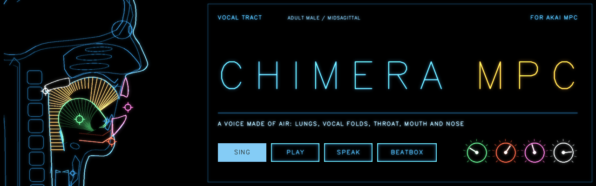
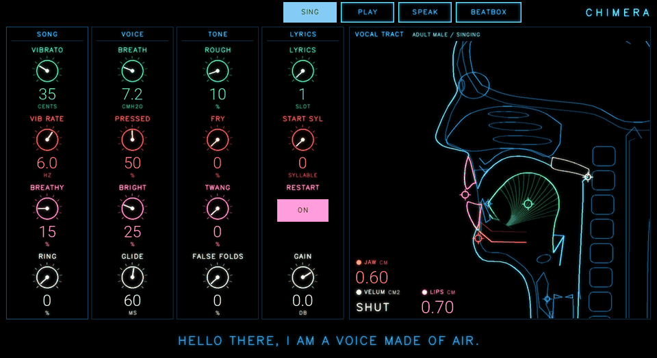
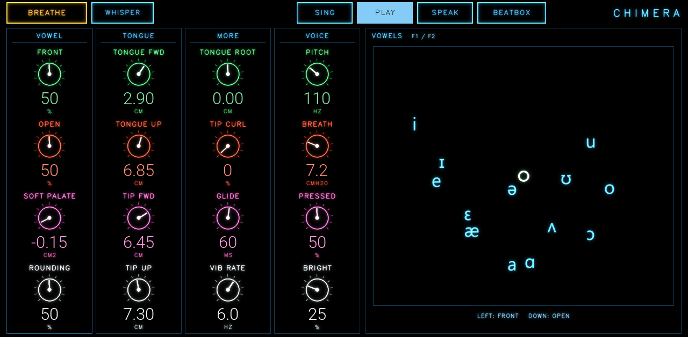
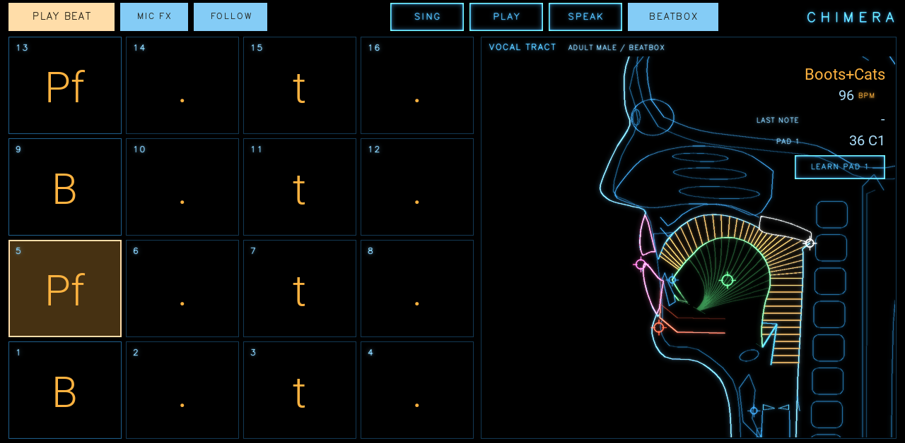
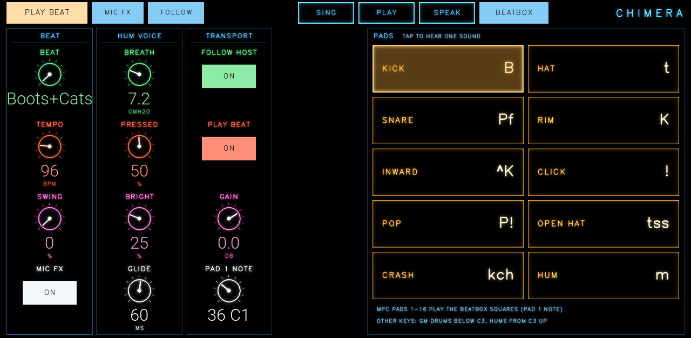
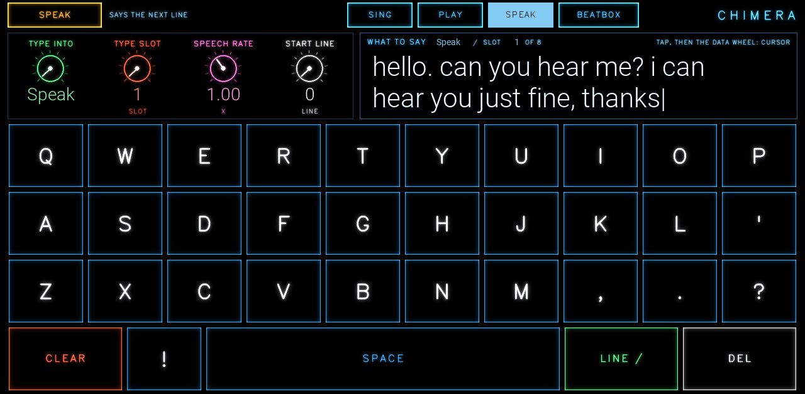

<p align="center">
  
</p>

<p align="center">
  
  
  
  
  
</p>

<p align="center">
  <b>CHIMERA's physical-model voice on Akai MPC standalone hardware.<br>
  It sings your lyrics, holds a vowel, speaks your lines and beatboxes, and none of it is a sample.</b><br>
  <sub>By anthonytheinventor · voice engine: CHIMERA by Jameson Hodge</sub>
</p>

<p align="center">
  <br>
  <sub>The SING page singing lyrics line 1, one note a syllable. The face's frames are the engine's own.</sub>
</p>

---

## The voice

[CHIMERA](https://github.com/jamesondh/chimera-vocal-synth) is a voice synthesizer by Jameson Hodge.
Every sound it makes comes from a simulated airway, not from samples. CHIMERA MPC runs CHIMERA's own
engine, with settings that let it fit a 32-bit MPC.

<table>
<tr>
<td width="50%" valign="top">

**What's simulated**

- the **lungs**, pushing air
- the **vocal folds**, opening and closing on it
- the **throat**
- the **mouth**: tongue, jaw and lips
- the **nose**, behind the soft palate

</td>
<td width="50%" valign="top">

**What you get on the MPC**

- four modes: **Sing**, **Play**, **Speak**, **Beatbox**
- four bodies: **Male**, **Female**, **Child**, **Blend**
- your own words, typed on the touch screen
- a 16-step beat played from the pads
- a head in profile that moves with the voice

</td>
</tr>
</table>

## Four modes

**Mode** picks how notes play. The mode chips in the top bar switch it from any page.

| Mode | A note... | Without a key |
|---|---|---|
| **Sing** (the default) | sings the next syllable of the lyrics | |
| **Play** | sings one held vowel at its pitch | **Breathe** holds the voice on; **Pitch** sets its pitch |
| **Speak** | says the next line of the chosen text | **Speak** says the next line; a consonant button says one consonant |
| **Beatbox** | hits a beatbox sound, or hums | **Play Beat** runs the 16-step beat; **Pad** hits one sound |

### Sing

Each note sings the next syllable of the lyrics, as CHIMERA's Sing mode does.

- **Lyrics** picks one of eight lines from `Content/lyrics.txt` in the plugin folder. Edit that file on
  the drive to sing your own words, or type them on the WORDS page.
- **Start Syl** sets where the lyrics start.
- With **Restart** on, Sing and Speak start again from Start Syl and Start Line each time the MPC's
  transport starts.
- The first moment after loading, while the pronunciation dictionary loads, a note sings "ah".

### Play

<p align="center">
  
  &nbsp;
  
</p>

A note sings one held vowel at its pitch. Play legato: the last key held sets the pitch.

- The voice breathes while a key is down, or all the time with **Breathe** on. **Pitch** sets the pitch
  without a key.
- How hard you play a key sets the breath (as Sing's notes do): soft keys breathe gently, hard ones push
  harder and brighter.
- The mouth and throat controls shape the vowel. Each one moves its own part of the head on the screen.
- The vowel pad (**Front** and **Open**, on the VOWEL page) blends CHIMERA's calibrated vowels and moves
  those controls to match. Drag across the chart to set both.

### Speak

<p align="center">
  
  &nbsp;
  
</p>

Each note says the next line of the chosen text.

- **Speech** picks one of eight blocks of lines in `Content/speech.txt` (blocks are separated by a blank
  line). **Start Line** sets where it starts and **Speech Rate** how fast it talks.
- C3 speaks at the body's natural pitch. Other keys move the whole line up or down, up to two octaves.
- With **IPA** on, the text is read as IPA.
- **Speak** says the next line without a key.
- On the SOUNDS page, **Consonant** says one consonant between two vowels, as CHIMERA's consonant chart
  does. Tap a button to say it; **Pad Vowel** picks the vowel around it.

### Beatbox

<p align="center">
  
  &nbsp;
  
</p>

A 16-step pattern of beatbox sounds, every one of them made by the mouth.

- **Beat** picks one of CHIMERA's seven patterns (it fills the steps, Tempo and Swing) or keeps
  **Your Beat**.
- **Play Beat** runs it on its own tempo. With **Follow Host** on, it plays along with the MPC's
  sequencer while that runs.
- The MPC's pads 1-16 (notes 36-51: set the track's Note Mapping to Chromatic C1) each play the sound in
  the BEATBOX square with the same number, and the square lights up. The beat lights its squares as it
  plays them.
- The squares are laid out as the MPC's pads, 1-4 on the bottom row and 13-16 on top, and Q-Link n turns
  square n.
- Other keys below C3 hit drum sounds (General MIDI's drum map), and keys from C3 up hum two octaves
  lower. **Pad** hits a sound without a key.
- **Mic FX** is CHIMERA's close-mic sound.

| | | | | | | | | | | |
|---|---|---|---|---|---|---|---|---|---|---|
| **Sound** | Kick | Hat | Snare | Rim | Inward | Click | Pop | Open Hat | Crash | Hum |
| **Step** | `B` | `t` | `Pf` | `K` | `^K` | `!` | `P!` | `tss` | `kch` | `m` |

## Typing your own words

<p align="center">
  
</p>

On the WORDS page (function key 5), pick **Type Into** (Speak or Sing: what Speak says or what Sing
sings) and **Type Slot** (1 to 8), then type on the keyboard.

| Key | What it does |
|---|---|
| **Del** | Takes back the character before the cursor. |
| **Clear** | Empties the slot. |
| **Line** | For Speak, starts a new line: each note says the next line. |

- The slot starts with the line from the text file. What you type replaces it and is saved with the
  project.
- A moment after you stop typing, the next note says (or sings) the new words. **Speak** says the next
  line without a key.
- The text box shows two rows of the text around the cursor (each row up to 30 characters, broken at
  spaces).
- To fix something earlier, tap the text box and turn the data wheel: the cursor (a thin |) moves a
  character at a time, and the keys type and Del deletes there. Picking another slot puts it back at the
  end.
- Type Slot and the slot that plays move together (Speech on the SPEAK page, or Lyrics on SING while
  typing for Sing), so the words on the WORDS page are the ones you hear.
- The keyboard types while the MPC's sequence is stopped, so taps recorded as automation never type
  again on playback.

## The screen

CHIMERA's look: glowing outlines on black. The controls are on the left, so the MPC's Q-Link window,
which slides in from the right, never covers them. On the right is the vocal tract, a full head in
profile.

<p align="center">
  
</p>

- The tongue, jaw, upper and lower lip, larynx and soft palate each move on their own, so turning one
  knob (or dragging the vowel pad) moves just that part. In Sing, Speak and Beatbox they all follow the
  voice.
- The amber lines across the mouth and throat glow brighter as the voice gets louder and go dark when
  it is silent.
- Each column of four Q-Links is one of CHIMERA's pages of four, colored green, red, pink and white from
  top to bottom, matching the column of four in the Q-Link window.
- Under the chin, the Jaw, Lips and Velum readouts follow their knobs. Velum says Shut while the soft
  palate closes off the nose.
- Buttons that are on are solid; off, they are an outline.
- On KIT, the pad last heard lights up, whether you tapped it, played its drum key, or the beat played
  it.
- The button at the top left is the page's main action (Breathe, Speak, Play Beat).

### Pages

| Page | Columns | Right side |
|---|---|---|
| **SING** | **SONG** Vibrato · Vib Rate · Breathy · Ring<br>**VOICE** Breath · Pressed · Bright · Glide<br>**TONE** Rough · Fry · Twang · False Folds<br>**LYRICS** Lyrics · Start Syl · Restart · Gain | the vocal tract, moving as it sings |
| **PLAY** | **VOICE** Pitch · Breath · Pressed · Vibrato<br>**TONE** Bright · Breathy · Rough · Fry<br>**MOUTH** Rounding · Lips Open · Protrude · Jaw<br>**THROAT** Soft Palate · Larynx · Twang · False Folds | the vocal tract |
| **VOWEL**<br><sub>press PLAY again</sub> | **VOWEL** Front · Open · Soft Palate · Rounding<br>**TONGUE** Tongue Fwd · Tongue Up · Tip Fwd · Tip Up<br>**MORE** Tongue Root · Tip Curl · Glide · Vib Rate<br>**VOICE** Pitch · Breath · Pressed · Bright | the vowel chart: drag to set Front and Open |
| **SPEAK** | **SPEAK** Speech Rate · Start Line · Speech · IPA<br>**VOICE** Breath · Pressed · Bright · Glide<br>**TONE** Breathy · Rough · Fry · Ring<br>**SHAPE** Jaw · Lips Open · Larynx · Soft Palate | the vocal tract |
| **SOUNDS**<br><sub>press SPEAK again</sub> | as SPEAK | the consonant buttons (tap one to say it) and the vowel around it |
| **BEATBOX** | the 16 steps, laid out as the MPC's pads | the vocal tract, the beat's name and tempo |
| **KIT**<br><sub>press BEATBOX again</sub> | **BEAT** Beat · Tempo · Swing · Mic FX<br>**HUM VOICE** Breath · Pressed · Bright · Glide<br>**TRANSPORT** Follow Host · Play Beat · Gain | the ten pads |
| **WORDS**<br><sub>function key 5</sub> | one row: Type Into · Type Slot · Speech Rate · Start Line | the text being typed, with a full-width keyboard below |
| **BODY**<br><sub>function key 6</sub> | **BODY** Body · Female · Child · Gain<br>**SETUP** MPE · Restart · Whisper · Breathe | the vocal tract and the credit; the body chips are in the top bar |

## Bodies and presets

<p align="center">
  
</p>

**Body** picks the airway: Male, Female, Child or Blend. **Blend** mixes the bodies with **Female** and
**Child**. Building a blended voice takes a moment: the previous body keeps playing until it is ready.

Eight built-in voices are in the MPC's preset list.

| | Preset | Body |
|---|---|---|
| 1 | **Init** | Male. CHIMERA's own defaults. |
| 2 | **Natural** | Male |
| 3 | **Breathy** | Female |
| 4 | **Belt** | Male |
| 5 | **Opera** | Male |
| 6 | **Airy** | Female |
| 7 | **Rough** | Male |
| 8 | **Child** | Child |

A preset sets the voice and the body (Gain through Child, the first 14 parameters) and leaves the mode,
your words, the mouth's shape and the beat as they are, so you can change voices in the middle of a
song. Your own settings, words and beat included, are saved with MPC presets of your own (save one from
the plugin's preset menu).

## Playing it

| Control | What it does |
|---|---|
| **Velocity** | In Play and Sing, sets the breath: soft keys breathe gently, hard ones push harder and brighter. |
| **Pitch wheel** | Bends ±2 semitones. |
| **Aftertouch** | Channel or key pressure breathes harder. |
| **MPE** | With **MPE** on, MIDI channels 2 to 16 carry one note each: its own bend (±48 semitones), pressure, and slide (CC 74), which moves the brightness. |

### On the beat

A mouth needs time to get ready. In Beatbox and Sing, while the MPC's sequence runs, sounds land a
fixed 180 ms after their notes, and the plugin reports that as its latency so the MPC can line it up
with the other tracks.

| Mode | While the sequence runs | With the sequence stopped |
|---|---|---|
| **Beatbox** | A mouth sound needs 100 to 174 ms to get ready before its hit. Every hit (the beat following the MPC, pads and drum keys) lands exactly 180 ms after its point in time. | Hits come as soon as the mouth can make them. |
| **Sing** | A syllable's consonants come before its vowel. Each note's vowel lands exactly 180 ms after the note, with its consonants started early by as much as they need, so the vowels fall on the beat. | Notes start at once. |

### Parameter notes

| Parameter | |
|---|---|
| **Gain** | Turns the voice's own level up or down before its output limiter, so a boost makes it louder up to the limit and never clips. |
| **Breath** | The lung pressure (cmH2O). |
| **Pressed** | How tightly the vocal folds close. |
| **Bright**, **Breathy**, **Rough**, **Fry** | Shape the sound of the vocal folds. |
| **Whisper** | Turns the voicing off. |
| **Ring**, **Twang** | Both narrow the tube just above the vocal folds; the larger of the two is used. |
| **Tip Fwd**, **Tip Up** | Place the tongue tip; at their starting values it rests where the jaw and tongue body put it. |
| A step's **m** (hum) | Plays at a fixed pitch; the Hum Bass pattern's own hum notes are not kept. |

## Install

1. Copy the folder `anthonytheinventor - VST - CHIMERA MPC` into a folder named `VST2 Plugins` on a
   drive. An SD card works.
2. The MPC needs **MPC OS 3.10.1 or later**, with **Preferences > Enhancements (Beta) > Enable
   Enhancements** and **External Plugin Support** turned on.
3. Load CHIMERA MPC as the plugin on a track. For the pads in Beatbox, set the track's Note Mapping to
   Chromatic C1.

<details>
<summary><b>How it fits on a 32-bit MPC</b></summary>
<br>

CHIMERA's engine is unchanged in what it models. To fit:

- the engine runs the airway at the sample rate, without CHIMERA's usual 2x oversampling;
- it uses longer sections in the trachea and nose;
- it updates the mouth shape every 4 control steps;
- it computes the airway in single precision with the MPC's vector unit.

Measured on an MPC One+:

| | CPU, of a 128-frame block |
|---|---|
| Playing | about 19 % |
| Playing, 99th percentile | about 27 % |
| Idle | 0.5 % |

</details>

<details>
<summary><b>Build from source</b></summary>
<br>

CHIMERA MPC builds with the MPC Plugin SDK. From the SDK folder:

```
python "plugins/CHIMERA MPC/build_chimera.py"
```

This builds the engine (`engine/`, Rust) for every target, then runs the SDK's `tools/build.py`, which
links it in. It needs rustup with the stable and nightly toolchains:

```
rustup target add x86_64-pc-windows-gnu aarch64-unknown-linux-gnu
rustup +nightly target add armv7-unknown-linux-gnueabihf
```

The 32-bit build uses nightly Rust because its vector code (NEON intrinsics) is not in stable Rust yet
on 32-bit ARM. The engine is built from the `mpc-opt` branch of a CHIMERA checkout at
`../../../chimera-vocal-synth`.

- `tools/make_skin.py` draws the screen (`skins/`, with previews in `build/preview/`).
- `tools/make_readme_images.py` redraws the pictures in this README with the skin's own drawing code
  and the engine's own face frames.
- `cargo test --release` in `engine/` runs the engine through its C interface, with WAVs in
  `build/listen/`.
- `engine/examples/presets.rs` renders each preset singing and holding a vowel, with its loudness.

</details>

<details>
<summary><b>Project layout</b></summary>
<br>

| Path | What it is |
|---|---|
| `plugin.json` | The manifest (name, manufacturer, uid). The `uid` must match the C++ `uniqueId`. |
| `src/CHIMERAMPC.cpp` | The plugin: parameters, MIDI, transport, output. |
| `src/chimera_mpc.h` | The engine's C interface. |
| `engine/` | CHIMERA's engine behind that interface (a Rust static library). |
| `engine/src/worker.rs` | The engine's own thread: dictionary, lyrics, spoken lines, blended voices. |
| `engine/src/close_mic.rs` | CHIMERA's close-mic sound. |
| `engine/src/face.rs` | Picks the face's frames each block (read-only parameters Jaw Pos, Tongue Pos, Lips Pos, Lower Lip, Larynx Pos, Sound Lvl and Velum Pos). |
| `engine/examples/fit_face.rs` | Renders speech, singing, consonants, beats, the vowel pad and the Play knobs, clusters the tongue outlines it sees and writes `engine/src/face_tables.rs` (the tongue frames and the map the engine picks them with). Run it again after changing the engine's articulation. |
| `engine/tests/api.rs` | The engine through its C interface. |
| `build_chimera.py` | The build. |
| `tools/make_skin.py` | Draws the screen (`skins/`, previews in `build/preview/`, including `face_*.png` check postures with the true outlines drawn over the layers) from the build's `build/params.json` and the vocal tract's outlines (`cargo run --release --example dump_face` in `engine/`, written to `build/face.json`). `ui.json` is no longer used once `skins/` exists. |
| `tools/make_readme_images.py` | Draws `docs/images/`. |
| `Content/lyrics.txt` | The eight lyrics lines. |
| `Content/speech.txt` | The eight blocks of spoken lines. |
| `Content/cmudict.txt.gz` | The CMU Pronouncing Dictionary. |
| `Content/CHIMERA-LICENSE.txt`, `Content/CMUDICT-LICENSE.txt` | The licenses, shipped with the plugin. |

</details>

## License

MIT: see [`LICENSE`](LICENSE).

- **CHIMERA** is MIT licensed, copyright Jameson Hodge. Its license is in
  [`Content/CHIMERA-LICENSE.txt`](Content/CHIMERA-LICENSE.txt).
- **The CMU Pronouncing Dictionary** is copyright Carnegie Mellon University, under the license in
  [`Content/CMUDICT-LICENSE.txt`](Content/CMUDICT-LICENSE.txt).
- The captions in the skin are drawn in **AVHershey Simplex** by Stewart C. Russell (CC0 / WTFPL), from
  Allen V. Hershey's stroke fonts.

<sub>CHIMERA MPC is an independent project, not made or endorsed by Jameson Hodge. Akai and MPC are
trademarks of their owners; CHIMERA MPC is not affiliated with or endorsed by them.</sub>
